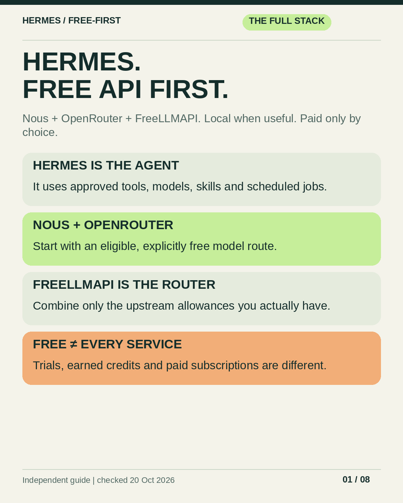

# Hermes: Complete Free-API Handbook

**Full Hermes setup + Nous Portal Free + OpenRouter + FreeLLMAPI + eligible additional allowances + optional local inference. Paid only with permission or a bounded, preauthorized exception.**

Private working repository for the complete setup guide and its shareable visual edition. No credentials, live Hermes configuration, model weights, or account/session data are included. This repository does not install or enforce a model router by itself.

## Read or download

- **[Complete handbook PDF — full Hermes and free-API setup](downloads/HERMES-FULL-FREE-API-HANDBOOK.pdf)**
- [Complete Markdown handbook — exact commands and source links](docs/SETUP.md)
- [Installed-provider inventory and honest access classifications](docs/PROVIDER-STATUS.md)
- [Eight-page visual PDF — clickable resource links](share-pack/FREE-FIRST-VISUAL-GUIDE.pdf)
- [Complete Telegram/share ZIP](downloads/HERMES-FREE-FIRST-SHARE-PACK.zip)
- [Numbered image cards](share-pack/)
- [Ready-to-paste Telegram caption](share-pack/TELEGRAM-CAPTION.txt)

### Preview



## AI-assisted setup / automation

- [Setup script](scripts/setup_free_first.py) — standard-library Python; dry-run first.
- [Portable AI skill](skills/hermes-free-first-setup/SKILL.md) — discovery, safe apply, credential handoff, optional local inference, and verification.
- [Setup instructions and rollback](skills/hermes-free-first-setup/references/SETUP.md).
- [Download the setup kit](downloads/hermes-free-first-setup-kit.zip) or [skill-only ZIP](downloads/hermes-free-first-setup-skill.zip).

```bash
# Preview the intended profile; does not change it.
python3 scripts/setup_free_first.py --home "$HOME/.hermes" --provider nous

# Only after reviewing and approving the listed changes:
python3 scripts/setup_free_first.py --home "$HOME/.hermes" --provider nous --apply --yes
```

Choose `--provider nous` or `--provider openrouter` explicitly. FreeLLMAPI/custom endpoints use the separate reviewed workflow in the skill/provider chapters; the helper does not label an arbitrary `auto` chain free. The helper verifies live free catalog pricing and tool support, backs up existing settings, pins free main/delegation/cron/auxiliary routes, clears automatic paid fallbacks, and verifies saved values. It attempts config rollback on a catchable failure. It does not read/store API keys, install Hermes/models, modify existing job pins, or implement automatic paid escalation. Review its exact replacement scope before applying.

**Give this to an AI:**

> Read `skills/hermes-free-first-setup/SKILL.md` and use its bundled script to set up free-first Hermes for me. Discover my intended profile, preview first, ask before applying, keep keys out of chat, audit background billing, and verify an actual tool call. No automatic paid escalation.

To install the skill, inspect and copy its entire folder into the intended client's skill directory without overwriting an existing skill. It can also be read directly from this repository. See the setup instructions for a guarded copy example and Windows caveats.

Offline tests: `python3 -m unittest discover -s tests -v`.
Optional real-CLI integration (disposable homes + public catalog, no model inference): `python3 tests/integration_setup.py`.

## Share on Telegram or elsewhere

Forward the **complete handbook PDF** for the full single-file guide. The visual PDF and eight image cards are a quick-start overview, not a substitute for the full provider chapters. For an image album, download/extract the ZIP and select PNGs **01–08** in numeric order. Sending them as files preserves sharper text. The ZIP also contains the complete handbook PDF/Markdown, both AI setup archives, and the caption.

While this repository is private, its GitHub links require access. Forward downloaded artifacts to share them without granting repository access. No public Pages site or public release is configured.

## What is covered

1. Hermes installation, tools, approvals, skills, memory, profiles, Telegram, and verification.
2. **Nous Portal Free:** signup/login, exact free models, API endpoint and entitlement caveats.
3. **OpenRouter:** keys, free catalogs, limits, and free-only fallback routing.
4. **FreeLLMAPI:** the correct project, desktop/server install, upstream keys, unified key, and chain auditing.
5. Pollinations earned-credit API use; why configured NanoGPT/Cheaper Inference are not automatically free.
6. Groq, Gemini, Mistral, Cerebras, NVIDIA, Cloudflare, Cohere and Hugging Face access classifications and setup links.
7. Using those APIs from scripts/other applications, local inference, background work, paid permission, and troubleshooting.

The visual cards are illustrated instructions, not screenshots of the application.

## Rebuild the visual pack

Use Python 3.10+ in an isolated virtual environment:

```bash
python3 -m venv .venv
source .venv/bin/activate
python -m pip install -r requirements.txt
python scripts/build_handbook.py
python scripts/package_setup.py
python scripts/build_visuals.py
```

The handbook builder combines `docs/HERMES-BASICS.md`, `docs/PROVIDER-CHAPTERS.md` and `docs/GUIDE-CORE.md` into the generated `docs/SETUP.md` and full linked PDF; edit those source chapters rather than the generated master. The visual generator reads the generated handbook, rewrites the eight PNGs/PDF and companion files in `share-pack/`, and regenerates the ZIP under `downloads/`. It does not change your Hermes configuration or make model/API calls. Edit the card copy/layout in the script; the full written guide is the source for the companion text, not an automatic slide-layout input.

The current renderer uses these Linux fonts:

- `/usr/share/fonts/liberation/LiberationSans-Regular.ttf`
- `/usr/share/fonts/liberation/LiberationSans-Bold.ttf`
- `/usr/share/fonts/TTF/JetBrainsMonoNerdFont-Regular.ttf`

Install those fonts or adjust the three font constants before rebuilding on a different machine. No font binaries are redistributed. `pdftoppm`/`pdfinfo` are optional local PDF-review tools, not build requirements.

## Checks and limitations

See [verification notes](docs/VERIFICATION.md). Documentation/model catalog checks are dated **20 October 2026**. Recheck pricing, model availability, and provider quotas before relying on them.

A free main model does not make external tools or hosted Jev free. A prompt policy is not a billing firewall. Free cloud inference sends prompts to third parties. Keep normal command approvals enabled and never commit API keys.

## Sources and attribution

Independent community guide, not an official Hermes, OpenRouter, or TypeSafe publication.

- [Hermes Agent / Nous Research](https://github.com/NousResearch/hermes-agent)
- [Hermes documentation](https://hermes-agent.nousresearch.com/docs/)
- [OpenRouter free models](https://openrouter.ai/models?pricing=free)
- [TypeSafe](https://typesafe.ai/)

Third-party projects, software, fonts, and model names retain their respective ownership and license terms. No additional public redistribution license has been selected for this private working repository.
